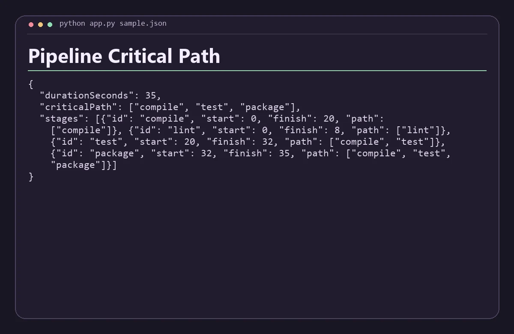

# Pipeline Critical Path

Compute earliest build-stage times and the critical path through a dependency graph.



## Run

Install Python 3.11 or newer. Run these commands from the repository root.

```sh
python app.py sample.json
```

Replace `sample.json` with a JSON file following the same structure. The app prints a JSON report to standard output.

Each stage has a unique id, nonnegative seconds, and an after array of stage IDs. Timing assumes unlimited workers and no resource contention. Cyclic or missing dependencies are rejected.

## Verify

Run `python check.py` with Python 3.11 or newer after the build step when applicable. The check verifies the bundled scenario and confirms that an invalid input returns an error.
